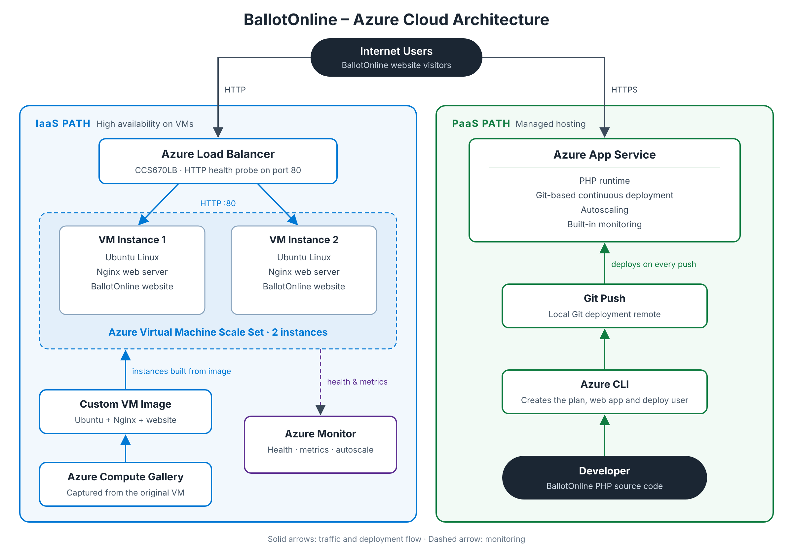

# BallotOnline — Azure Cloud Orchestration & Automation

[](https://azure.microsoft.com/)


[](https://github.com/oteyami2001/BallotOnline-Azure-Cloud-Orchestration/actions/workflows/validate.yml)

Azure cloud engineering proof of concept demonstrating **IaaS, PaaS,
high availability, load balancing, reusable VM images, Infrastructure
as Code, Git deployment, monitoring, security, troubleshooting, and
multi-cloud architecture analysis**.

---

## Architecture



---

## Project Overview

BallotOnline needed an evaluation of Microsoft Azure as an alternative
and complementary cloud platform to AWS. I implemented two Azure
deployment models.

### IaaS Architecture

```text
Internet
   |
   v
Azure Load Balancer
   |
   v
Azure VM Scale Set
   |
   +----------------+
   |                |
   v                v
VM Instance 1    VM Instance 2
Ubuntu/Nginx     Ubuntu/Nginx
   |                |
   +-------+--------+
           |
           v
Azure Compute Gallery Image
```

### PaaS Architecture

```text
Developer
   |
Azure CLI + Git
   |
   v
Azure App Service
   |
   v
BallotOnline
```

---

## What I Built

| Area | Highlights |
|---|---|
| **Azure infrastructure** | Ubuntu VM with Nginx · Azure Compute Gallery golden image · VM Scale Set · Azure Load Balancer · HTTP health monitoring · multi-instance web tier |
| **Azure PaaS** | Linux App Service · PHP runtime · Azure CLI provisioning · Git-based deployment · App Service monitoring · scaling evaluation |
| **Automation & IaC** | ARM templates · parameterized examples · Bash automation · Git version control · GitHub Actions validation |
| **Security** | SSH keys only (password login disabled) · Network Security Groups · managed identity · Trusted Launch, Secure Boot, vTPM · no public IPs on backend instances · sanitized public artifacts |

---

## High Availability

The IaaS implementation evolved from a single VM into a load-balanced,
multi-instance architecture.

```text
                    Internet
                       |
                       v
             +-------------------+
             |    Azure Load     |
             |     Balancer      |
             +---------+---------+
                       |
             +---------+---------+
             |                   |
             v                   v
        VMSS Instance 1     VMSS Instance 2
        Ubuntu + Nginx      Ubuntu + Nginx
```

| Configuration | Value |
|---|---|
| VMSS minimum | 1 |
| VMSS default | 2 |
| VMSS maximum | 2 |
| Health protocol | HTTP |
| Health port | 80 |
| Health path | `/` |
| Backend public IPs | Disabled |

---

## IaaS vs. PaaS

| Area | Azure IaaS | Azure PaaS |
|---|---|---|
| Service | VM / VM Scale Set | App Service |
| OS administration | Customer | Azure |
| Web server administration | Customer | Azure |
| Scaling | VM Scale Set | App Service plan |
| Load distribution | Azure Load Balancer | Built into the platform |
| Infrastructure control | High | Lower |
| Operational overhead | Higher | Lower |

The project showed that the choice of service model affects day-to-day
operational responsibility as much as the choice of cloud provider.

---

## AWS ↔ Azure Mapping

| AWS | Microsoft Azure |
|---|---|
| EC2 | Azure Virtual Machines |
| AMI | Azure Compute Gallery image |
| Auto Scaling Group | VM Scale Set |
| Elastic Load Balancing | Azure Load Balancer |
| Elastic Beanstalk | Azure App Service |
| CloudWatch | Azure Monitor |
| IAM | Entra ID / Azure RBAC |
| Trusted Advisor | Azure Advisor |
| Systems Manager | Azure Automation / Arc |
| CloudFormation | ARM / Bicep |

See the full [AWS vs. Azure comparison](docs/11-aws-vs-azure.md).

---

## Troubleshooting Highlights

Real issues solved during the project:

| Issue | Root cause | Fix |
|---|---|---|
| Nginx install failed with `404 Not Found` | Stale APT package index | `apt-get update`, then reinstall |
| App Service Plan creation failed | No regional compute quota in East US | Deployed to West US 3 |
| Deployment username rejected | Usernames must be unique across all of Azure | Chose a unique username |
| `git push` authentication failed | Git remote still used the old username | `git remote set-url` |
| Azure CLI rejected `--resource-group` | Typographic dash copied from a document | Retyped with ASCII hyphens |

See the complete [troubleshooting runbook](docs/08-troubleshooting-runbook.md).

---

## Documentation

| # | Guide | Automation |
|---|---|---|
| 01 | [Azure VM deployment](docs/01-azure-vm-deployment.md) | [`install-nginx.sh`](infrastructure/scripts/install-nginx.sh) |
| 02 | [Azure Compute Gallery image](docs/02-azure-vm-image.md) | [VM ARM template](infrastructure/arm/vm-template.json) |
| 03 | [VM Scale Set and load balancer](docs/03-vm-scale-set-load-balancer.md) | [VMSS ARM template](infrastructure/arm/vmss-template.json), [`vmss-user-data.sh`](infrastructure/scripts/vmss-user-data.sh) |
| 04 | [Load balancer and health probe](docs/04-load-balancer-health-probe.md) | — |
| 05 | [Azure App Service](docs/05-azure-app-service.md) | [`deploy-app-service.sh`](infrastructure/scripts/deploy-app-service.sh) |
| 06 | [Git continuous deployment](docs/06-continuous-deployment.md) | — |
| 07 | [Monitoring and autoscaling](docs/07-monitoring-autoscaling.md) | [Monitoring CLI examples](infrastructure/monitoring/) |
| 08 | [Troubleshooting runbook](docs/08-troubleshooting-runbook.md) | — |
| 09 | [Operational excellence](docs/09-operational-excellence.md) | — |
| 10 | [Security and governance](docs/10-security-governance.md) | [`security/`](security/) |
| 11 | [AWS vs. Azure](docs/11-aws-vs-azure.md) | — |
| 12 | [Repository validation](docs/12-repository-validation.md) | [`validate.yml`](.github/workflows/validate.yml) |
| 13 | [Interview preparation](docs/13-interview-prep.md) | — |

### Architecture Decisions

- [ADR-001 — Evaluate PaaS alongside IaaS](docs/adr/ADR-001-iaas-vs-paas.md)
- [ADR-002 — Load-balanced VM Scale Set](docs/adr/ADR-002-load-balanced-vmss.md)

---

## Repository Structure

```text
.
├── .github/workflows/
│   └── validate.yml             # GitHub Actions repository validation
├── architecture/                # Architecture diagram (SVG/PNG) and component notes
├── app-service/                 # PaaS deployment notes
├── docs/
│   ├── 01 … 13                  # Implementation guides, runbook, interview prep
│   └── adr/                     # Architecture Decision Records
├── infrastructure/
│   ├── arm/                     # Sanitized ARM templates + example parameters
│   ├── monitoring/              # Monitoring strategy and az monitor examples
│   └── scripts/                 # Bash automation (Nginx, VMSS bootstrap, App Service)
└── security/                    # Security principles and production recommendations
```

---

## Technologies

`Microsoft Azure` `Azure VM` `VM Scale Sets` `Azure Load Balancer`
`Azure Compute Gallery` `Azure App Service` `Azure Monitor`
`Azure CLI` `ARM` `Linux` `Ubuntu` `Nginx` `PHP` `Bash`
`Git` `GitHub Actions` `IaaS` `PaaS`

---

## Key Skills Demonstrated

Cloud architecture · Azure infrastructure engineering · IaaS and PaaS ·
High availability · Horizontal scaling · Load balancing · Infrastructure
as Code · Cloud automation · Linux administration · DevOps · Monitoring ·
Troubleshooting · Cloud security · Governance · AWS/Azure service mapping
· Architecture decision records

---

## Project Status

**Completed Azure Cloud Orchestration & Automation Proof of Concept**

This repository contains sanitized portfolio artifacts based on the
completed implementation. Credentials, private keys, subscription
identifiers and other sensitive environment-specific values are not
included.

---

## Author

**Thierry A. OTEYAMI**
Cloud Engineer | Oracle DBA | AWS & Azure | Infrastructure as Code |
Cloud Migration | DevOps

GitHub: [@oteyami2001](https://github.com/oteyami2001)
