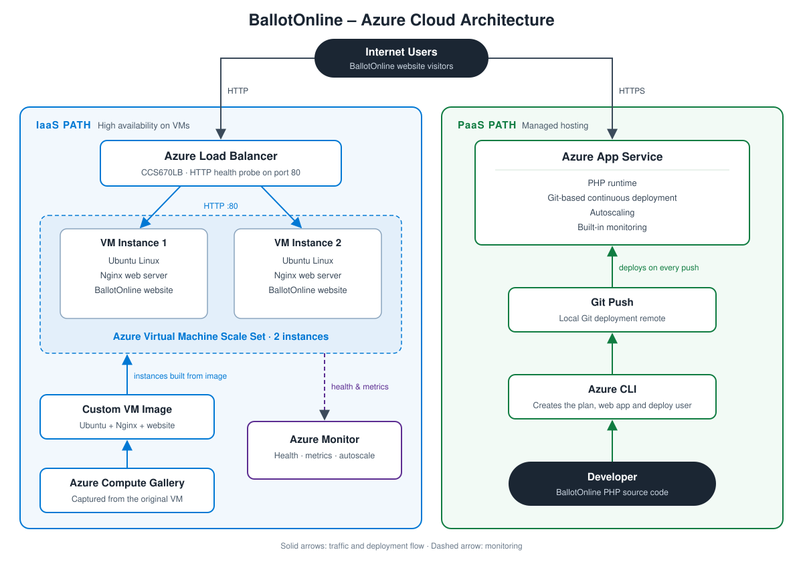

# BallotOnline – Azure Cloud Orchestration & Automation

[](https://azure.microsoft.com/)


## Overview

This project demonstrates the design, deployment, orchestration, and
automation of the **BallotOnline web application on Microsoft Azure**.

The proof of concept evaluates both **Infrastructure as a Service (IaaS)**
and **Platform as a Service (PaaS)** architectures while demonstrating
high availability, horizontal scaling, load balancing, infrastructure
automation, continuous deployment, monitoring, and cloud
troubleshooting.

The project also compares Microsoft Azure services with equivalent
Amazon Web Services (AWS) capabilities to evaluate Azure as part of a
multi-cloud strategy.

---

## Architecture



The proof of concept hosts the BallotOnline website on two Azure paths:

**IaaS path: high availability on virtual machines**

- An Ubuntu VM was configured with Nginx and the BallotOnline website.
- That VM was captured as a reusable custom image in **Azure Compute Gallery**.
- A **VM Scale Set** with two instances was deployed from that image.
- An **Azure Load Balancer** (`CCS670LB`) spreads HTTP traffic across the
  instances and checks their health on port 80.
- **Azure Monitor** tracks instance health and metrics.

**PaaS path: managed web hosting**

- **Azure CLI** creates the App Service plan, the web app and the
  deployment user.
- The PHP site is deployed to **Azure App Service** with a `git push` to
  its Git deployment remote.
- App Service handles the runtime, scaling and monitoring, so there are
  no servers to manage.

See [`architecture/`](architecture/) for details on each component.

---

## Technologies

- Microsoft Azure
- Azure Virtual Machines
- Azure VM Scale Sets
- Azure Load Balancer
- Azure Compute Gallery
- Azure App Service
- Azure Monitor
- Azure CLI
- Azure Resource Manager (ARM)
- Linux / Ubuntu
- Nginx
- Git
- Bash
- PHP
- Infrastructure as Code (IaC)
- Continuous Deployment

---

## Project Implementation

The project was implemented through several cloud engineering phases:

1. Azure environment exploration and architecture planning
2. Ubuntu virtual machine provisioning
3. Nginx web server installation and configuration
4. BallotOnline website deployment
5. Azure VM image creation
6. Azure Compute Gallery configuration
7. Virtual Machine Scale Set deployment
8. Azure Load Balancer implementation
9. Application health monitoring
10. Azure App Service deployment
11. Azure CLI automation
12. Git-based continuous deployment
13. Azure monitoring and autoscaling
14. AWS vs. Azure architecture comparison

### Implementation Guides

| Stage | Guide | Automation |
|---|---|---|
| 01 | [Azure VM and Nginx deployment](docs/01-azure-vm-deployment.md) | [`install-nginx.sh`](infrastructure/scripts/install-nginx.sh) |
| 02 | [Azure Compute Gallery and VM image](docs/02-azure-vm-image.md) | [ARM template](infrastructure/arm/vm-template.json) |
| 03 | [VM Scale Set and load balancer](docs/03-vm-scale-set-load-balancer.md) | [VMSS ARM template](infrastructure/arm/vmss-template.json), [`vmss-user-data.sh`](infrastructure/scripts/vmss-user-data.sh) |

---

## High Availability

The IaaS implementation uses an Azure Virtual Machine Scale Set behind an
Azure Load Balancer. The architecture demonstrates:

- Multiple VM instances
- Horizontal scaling
- Load-balanced HTTP traffic
- Application health monitoring
- Reusable VM images
- Availability-zone-aware deployment
- Automatic instance management

---

## Infrastructure as Code

Azure Resource Manager templates were exported and analyzed to
demonstrate repeatable infrastructure deployment.

The repository will include sanitized infrastructure definitions and
deployment examples without credentials or subscription-specific
secrets.

---

## Continuous Deployment

The PaaS implementation uses Azure App Service with Git-based deployment.

```text
Developer
    |
    v
Git Repository
    |
    | git push
    v
Azure App Service
    |
    v
Automated Deployment
    |
    v
BallotOnline Website
```

This demonstrates a simplified DevOps workflow without manually managing
the underlying web servers.

---

## Troubleshooting Experience

Real deployment issues were identified and resolved during the project,
including:

- Ubuntu APT package-index errors
- Nginx installation failures
- Azure regional compute quota limitations
- Globally unique Azure publishing username conflicts
- Git remote authentication problems
- Azure CLI command formatting errors

These scenarios demonstrate practical cloud troubleshooting rather than
only successful deployment paths.

---

## AWS vs. Azure

| Capability       | AWS                    | Microsoft Azure        |
|------------------|------------------------|------------------------|
| Virtual Compute  | EC2                    | Azure Virtual Machines |
| Auto Scaling     | Auto Scaling Groups    | VM Scale Sets          |
| Load Balancing   | Elastic Load Balancing | Azure Load Balancer    |
| PaaS Web Hosting | Elastic Beanstalk      | Azure App Service      |
| Identity         | IAM                    | Microsoft Entra ID     |
| Recommendations  | Trusted Advisor        | Azure Advisor          |
| Monitoring       | CloudWatch             | Azure Monitor          |

---

## Repository Structure

```text
BallotOnline-Azure-Cloud-Orchestration/
|
+-- README.md
+-- architecture/
+-- infrastructure/
|   +-- arm/
|   +-- scripts/
+-- website/
+-- docs/
+-- screenshots/
|   +-- vm/
|   +-- scale-set/
|   +-- load-balancer/
|   +-- app-service/
|   +-- deployment/
|   +-- monitoring/
+-- reports/
```

---

## Key Skills Demonstrated

Cloud Architecture • Microsoft Azure • IaaS • PaaS • Linux • Nginx •
VM Scale Sets • Load Balancing • High Availability • Azure App Service •
Azure CLI • ARM Templates • Infrastructure as Code • Git • Continuous
Deployment • Monitoring • Autoscaling • Troubleshooting • AWS/Azure
Multi-Cloud Architecture

---

## Author

**Thierry A. Oteyami**
Cloud Engineer | Oracle Database Administrator | Software Engineer

GitHub: [@oteyami2001](https://github.com/oteyami2001)

---

## Project Status

**Completed Proof of Concept**

Future repository updates will include architecture diagrams,
infrastructure templates, deployment scripts, implementation
documentation, screenshots, troubleshooting notes, and interview
preparation material.
